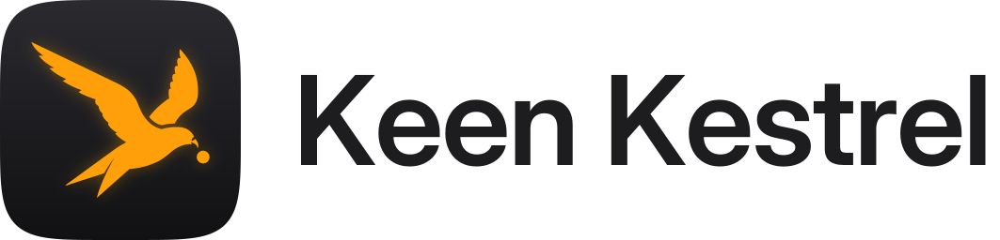

  <picture>
    <source media="(prefers-color-scheme: dark)" srcset="assets/brand/kestrel-logo-dark.svg">
    
  </picture>

<strong>Self-hosted error tracking and privacy-friendly analytics in one small binary.</strong>

  
  

> **Status: early development.** The skeleton runs: setup and sign-in with two-factor authentication,
> users, API tokens, projects and their DSN keys (web pages, REST API and one MCP tool), in 26 languages.
> It can't receive events yet; ingest is the next phase. The design is in [`docs/design.md`](docs/design.md);
> to build and run it, see [`docs/development.md`](docs/development.md).

Keen Kestrel answers two questions about the apps and sites you run:

- **What broke?** Errors and crashes from the official Sentry SDKs (iOS/Swift, JavaScript, Rust, Python,
  Go and more) work unchanged. Issues are grouped, alerts go to the same ~40 channels as
  [Vigilant Vole](https://github.com/Ferdinand99/Vigilant-Vole), and iOS crashes are symbolicated from the
  dSYMs that `sentry-cli` uploads.
- **How is it used?** App signals and website pageviews without cookies or stored IP addresses, with
  dashboards for users, versions, devices, pages and referrers.

One Rust binary and SQLite: no Kafka, ClickHouse, Redis or Postgres. It shares its design language and
foundations with Vigilant Vole and runs on Docker, Unraid, Proxmox or plain Linux.

## Planned for v1

| Errors | Analytics |
|---|---|
| Sentry-compatible ingest (envelopes, sessions, feedback, attachments) | App signals via the `KestrelKit` Swift package |
| Issue grouping, search, resolve/ignore/merge, regressions | Web pageviews via a script under 2 KB |
| iOS/macOS symbolication from dSYMs (`sentry-cli` compatible) | Daily, weekly and monthly users, versions, devices, locales |
| Release health: crash-free sessions and users | Pages, referrers, UTM, browsers |
| Alerts: new issue, regression, spike, first crash in a release | No cookies, no stored IPs, daily-rotating salts |
| REST API, OpenAPI, MCP tools for coding agents | Same projects, keys and releases as errors |

Not in v1: performance tracing, session replay, JavaScript source maps (planned for v1.1), funnels and
cohorts. See [`docs/design.md`](docs/design.md) for the full scope and the phases.

## License

[MIT](LICENSE)
